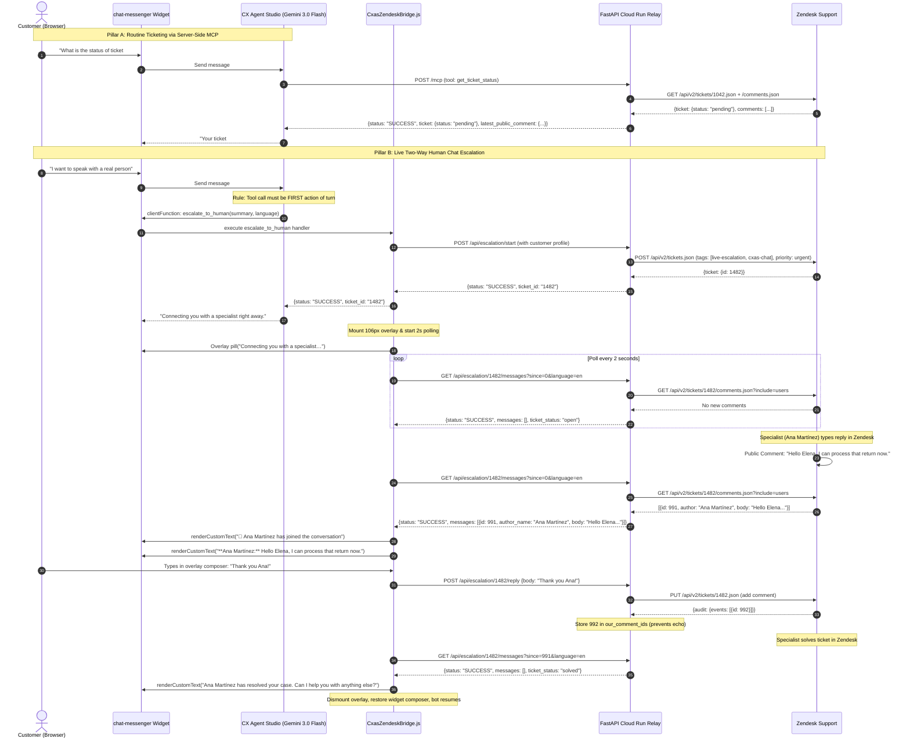

# CX Agent Studio & Zendesk Connector Kit

[](https://opensource.org/licenses/Apache-2.0)
[](https://www.python.org/downloads/)
[](https://cloud.google.com/products/gemini)
[](https://fastapi.tiangolo.com)
[](https://modelcontextprotocol.io)

An enterprise-ready, turnkey integration kit connecting **Google Cloud CX Agent Studio (CXAS / GECX)** with **Zendesk Support**.

This repository provides everything needed to deploy and operate two complementary customer engagement patterns in production:
1. **Server-Side Zendesk MCP Connector (Pillar A)** — Routine ticket search, status queries, asynchronous ticket creation, and comment tracking directly from your CXAS AI agents via Streamable HTTP MCP (`/mcp`).
2. **Live Two-Way Human Chat Escalation (Pillar B)** — Instant bot-to-human handoff from the `<chat-messenger>` widget directly to Zendesk Support specialists. The specialist's replies appear in the customer's chat bubbles in **~2.0 seconds**, and the AI assistant automatically resumes when the ticket is marked Solved.

---

## Architecture Overview

```
                                  CUSTOMER BROWSER
    ┌──────────────────────────────────────────────────────────────────────────┐
    │                                                                          │
    │   [ <chat-messenger> ]                                                   │
    │          │                                                               │
    │          │ (Turn 1..N: AI Conversation)                                  │
    │          ▼                                                               │
    │      CX Agent Studio (Gemini 3.0 Flash / Gemini 3.1 Pro)                 │
    │          │                                                               │
    │          ├──────────► [ Server-Side Zendesk MCP Toolset ]                │
    │          │                  │ (search_tickets, get_ticket_status, etc.)  │
    │          │                  ▼                                            │
    │          │            FastAPI Server (/mcp)                              │
    │          │                  │                                            │
    │          │                  ▼                                            │
    │          │            Zendesk REST API v2                                │
    │          │                                                               │
    │          │ (Customer: "I want to speak with a human agent")              │
    │          ▼                                                               │
    │    calls clientFunction: escalate_to_human(summary, language, order_id)  │
    │          │                                                               │
    │          ▼                                                               │
    │    CxasZendeskBridge (presenter handler registered in browser)           │
    │          │                                                               │
    │          ├─► POST /api/escalation/start                                  │
    │          ├─► Mounts 106px floating overlay composer                      │
    │          └─► Starts 2s poll loop for specialist comments                 │
    │                                                                          │
    └──────────────────────────────────┬───────────────────────────────────────┘
                                       │
                                       ▼
                     CLOUD RUN SERVICE (FastAPI Relay & MCP)
    ┌──────────────────────────────────────────────────────────────────────────┐
    │                                                                          │
    │  POST /api/escalation/start                                              │
    │    └──► POST /api/v2/tickets.json                                        │
    │         - requester: {name: customer_name, email: customer_email}        │
    │         - tags: ["live-escalation", "cxas-chat"]                         │
    │         - priority: "urgent"                                             │
    │                                                                          │
    │  GET /api/escalation/{escalation_id}/messages?since={cursor}             │
    │    └──► GET /api/v2/tickets/{ticket_id}/comments.json?include=users      │
    │         - Filters: public==true, author!=requester, id not in our_ids    │
    │         - Side-loads specialist display name (e.g. "Ana Martínez")       │
    │                                                                          │
    │  POST /api/escalation/{escalation_id}/reply                              │
    │    └──► PUT /api/v2/tickets/{ticket_id}.json                             │
    │         - Submits customer message as public comment                     │
    │         - Tracks comment ID in `our_comment_ids` to prevent echoing      │
    │                                                                          │
    └──────────────────────────────────┬───────────────────────────────────────┘
                                       │
                                       ▼
                           ZENDESK AGENT WORKSPACE
    ┌──────────────────────────────────────────────────────────────────────────┐
    │                                                                          │
    │  Ticket #1482 (Priority: Urgent, Requester: Elena Gómez)                 │
    │  Specialist types reply: "Hello Elena, I am looking at your order now."  │
    │  Specialist marks ticket 'Solved' ──► Bot detects and resumes            │
    │                                                                          │
    └──────────────────────────────────────────────────────────────────────────┘
```

### Complete Interaction Flow (Mermaid)



---

## 60-Second Local Quickstart (Zero Credentials Required)

You can run and test the complete connector kit locally without an active Zendesk account using the built-in **Mock Specialist Simulator**.

### 1. Clone & Configure
```bash
git clone https://github.com/your-org/cxas-zendesk-connector-kit.git
cd cxas-zendesk-connector-kit

# Copy environment template
cp .env.example .env
```

### 2. Launch Local Server in Mock Mode
```bash
# Install dependencies (or run `make install` / `make install-dev`)
python3 -m venv .venv
source .venv/bin/activate
pip install -r requirements.txt

# Start backend with Mock Specialist Simulator enabled (or run `make run-mock`)
ZENDESK_MOCK_MODE=true uvicorn backend.server:app --host 0.0.0.0 --port 8080 --reload
```

### 3. Verify Endpoints & Routes
- **Sandbox Workbench UI:** `http://localhost:8080/` (serves `frontend/index.html` with the `<cxas-preview-messenger>` widget, MCP tool tester, and Specialist Simulator)
- **MCP Endpoint:** `http://localhost:8080/mcp` (Streamable HTTP MCP server)
- **Health & Mode Summary:** `GET http://localhost:8080/api/health`
- **Escalation Relay Routes:**
  - `POST /api/escalation/start` — open a live escalation ticket
  - `GET /api/escalation/{escalation_id}/messages?since={cursor}&language={lang}` — poll specialist replies + ticket status
  - `POST /api/escalation/{escalation_id}/reply` — forward the customer's reply
  - `GET /api/escalation` — list active escalations (powers the simulator console)
- **Specialist Simulator & REST Tool Preview:**
  - `POST /api/simulator/escalation/{escalation_id}/specialist-reply` — post a simulated specialist reply
  - `POST /api/simulator/escalation/{escalation_id}/status` — update simulated ticket status (`solved` triggers AI handback)
  - `POST /api/mcp-preview/{tool_name}` — invoke an MCP tool over plain REST
- **API Docs (Swagger UI):** `http://localhost:8080/docs`

### Makefile Targets
```bash
make help                # List all available Makefile commands
make install             # Install runtime dependencies
make install-dev         # Install runtime + pytest + Playwright Chromium
make run                 # Run backend on PORT (default 8080)
make run-mock            # Run backend explicitly in ZENDESK_MOCK_MODE=true
make test                # Run all tests (unit + MCP + Playwright E2E)
make test-unit           # Run relay and MCP unit/contract tests
make test-e2e            # Run Playwright Chromium E2E browser tests
make docker-build        # Build container image
make docker-run          # Run container image locally on PORT
make setup-cxas          # Provision CXAS tool & MCP toolset (requires PROJECT_ID, APP_ID, BACKEND_URL)
make setup-cxas-dry-run  # Dry-run CXAS provisioning without sending network requests
make clean               # Remove Python/pytest caches
```

---

## Step-by-Step Production Setup

### Prerequisite 1: Zendesk API Credentials
1. In Zendesk Admin Center, navigate to **Apps and integrations** > **Zendesk API**.
2. Enable **Token Access** and create an API Token.
3. Note your credentials:
   - Subdomain: e.g., `acmesupport` (`acmesupport.zendesk.com`)
   - Agent Email: e.g., `support-lead@example.com`
   - API Token: e.g., `aBc123XyZ456...`

---

### Step 2: Deploy Cloud Run Backend & Secret Manager

#### Option A: One-Command Bash Deployment (Recommended)
```bash
chmod +x scripts/deploy_gcp.sh
export GCP_PROJECT_ID="your-project-id"
export GCP_REGION="us-central1"
export ZENDESK_SUBDOMAIN="acmesupport"
export ZENDESK_EMAIL="support-lead@example.com"
export ZENDESK_API_TOKEN="your-api-token"

./scripts/deploy_gcp.sh
```

#### Option B: Terraform Deployment
```bash
cd terraform
terraform init
terraform apply \
  -var="project_id=your-project-id" \
  -var="region=us-central1" \
  -var="zendesk_subdomain=acmesupport" \
  -var="zendesk_email=support-lead@example.com" \
  -var="zendesk_api_token=your-api-token"
```

The deployment will output your live service URL:
```
Service URL: https://cxas-zendesk-connector-c2rnccvaca-uc.a.run.app
MCP Endpoint: https://cxas-zendesk-connector-c2rnccvaca-uc.a.run.app/mcp
```

---

### Step 3: Wire Tools in CX Agent Studio

#### Automated CLI Configuration
Run `scripts/setup_cxas.py` (or `make setup-cxas`) to idempotently create or update both the `escalate_to_human` `clientFunction` tool and the `zendesk_mcp_connector` MCP toolset in your CX Agent Studio app:
```bash
python3 scripts/setup_cxas.py \
  --project-id your-project-id \
  --location us \
  --app-id your-cxas-app-uuid \
  --backend-url https://cxas-zendesk-connector-c2rnccvaca-uc.a.run.app \
  --auth service-agent-id-token
```
Supported `scripts/setup_cxas.py` flags:
- `--project-id` (required): Google Cloud project that owns the CXAS app.
- `--location` (default `us`): CXAS app location (e.g., `us`, `eu`, `global`).
- `--app-id` (required): CXAS app UUID.
- `--backend-url` (required): Public `https://` base URL of the connector (MCP endpoint is `{backend_url}/mcp`).
- `--auth` (`service-agent-id-token` | `none`, default `service-agent-id-token`): Authentication mode for CXAS-to-MCP requests.
- `--skip-tool`: Skip creating/updating `escalate_to_human`.
- `--skip-toolset`: Skip creating/updating `zendesk_mcp_connector`.
- `--dry-run`: Print the CES v1beta REST requests without sending them.

#### Manual Console Configuration (Alternative)
1. Open the [Google Cloud CX Agent Studio Console](https://console.cloud.google.com/gen-app-builder/engines).
2. **Add MCP Toolset:**
   - Go to **Tools** > **Create Toolset**.
   - Type: **Model Context Protocol (MCP)**.
   - Name: `zendesk_mcp_connector` (template in [`cxas/tools/zendesk_mcp_toolset.json`](./cxas/tools/zendesk_mcp_toolset.json)).
   - Server Address: `https://your-cloud-run-service.run.app/mcp`.
   - Exposed Tools: `search_tickets`, `get_ticket_status`, `create_offline_ticket`, `add_ticket_comment`.
3. **Add Client Function Tool:**
   - Go to **Tools** > **Create Tool**.
   - Type: **Client Function**.
   - Name: `escalate_to_human`.
   - Paste the definition from [`cxas/tools/escalate_to_human.json`](./cxas/tools/escalate_to_human.json).
4. **Update Agent Instructions:**
   - Attach both tools to your customer support spoke agent.
   - Paste the instruction taskflow from [`cxas/instructions/support_spoke_prompt.md`](./cxas/instructions/support_spoke_prompt.md).

---

### Step 4: Embed `<chat-messenger>` & Bridge in Your Web App

Include the official Google Cloud chat widget, the Zendesk escalation bridge CSS/JS served from your connector root, and initialize `window.CxasZendeskBridge.init(...)` with your customer's authenticated session profile:

```html
<!DOCTYPE html>
<html lang="en">
<head>
  <meta charset="UTF-8">
  <title>Customer Support Portal</title>
  
  <!-- 1. Google Cloud CX Agent Studio Widget SDK (Pinned Version) -->
  <link rel="stylesheet" href="https://www.gstatic.com/chat-messenger/sdk/prod/v1.16/themes/chat-messenger-default.css">
  <script src="https://www.gstatic.com/chat-messenger/sdk/prod/v1.16/chat-messenger.js" defer></script>
  
  <!-- 2. CXAS Zendesk Escalation Bridge Styling -->
  <link rel="stylesheet" href="https://your-cloud-run-service.run.app/cxas-zendesk-bridge.css">
</head>
<body>

  <!-- 3. Chat Messenger Custom Element -->
  <chat-messenger url-allowlist="*" deployment-id="your-deployment-uuid">
    <chat-messenger-container chat-title="Customer Support"></chat-messenger-container>
  </chat-messenger>

  <!-- 4. CXAS Zendesk Bridge Runtime -->
  <script src="https://your-cloud-run-service.run.app/cxas-zendesk-bridge.js"></script>
  <script>
    // 5. Initialize the Bridge with Authenticated Customer Identity
    window.addEventListener('DOMContentLoaded', () => {
      window.CxasZendeskBridge.init({
        apiBase: 'https://your-cloud-run-service.run.app', // '' = same origin
        language: 'en',                                    // 'en' | 'es' | 'fr' | 'de'
        pollIntervalMs: 2000,
        getCustomer: () => ({
          name: 'Elena Gómez',
          email: 'elena.gomez@example.com'
        })
      });
    });
  </script>
</body>
</html>
```

---

## Key Production Engineering Decisions

### 1. Why `presenter.registerClientSideFunctionForAllTools`?
The official SDK (`chat-messenger.js`) provides two client-function registration methods:
- `registerClientSideFunction(toolPath, lastSegment, handler)`: Writes to an exact-path map (`presenter.ka.i`). If the tool path contains a project number instead of project ID, or if the tool resource uses a UUID, registration **silently misses**.
- `registerClientSideFunctionForAllTools(toolName, handler)`: Writes to a bare-name fallback map (`presenter.ka.j`). It matches the function name directly, completely eliminating project ID/number ambiguity.
- **Critical SDK Nuance:** This method is defined on `messenger.presenter`, **NOT** on the `<chat-messenger>` DOM element. Calling it on the element returns `undefined`.

### 2. Why the 106px Closed Shadow-DOM Overlay Composer?
The `<chat-messenger>` message list and input composer are encapsulated within closed shadow roots.
- Native inputs cannot be hidden or disabled via CSS rules or attribute modifications.
- If left accessible during a live human escalation, the user might submit messages simultaneously to both the Gemini LLM and the Zendesk human agent.
- Precise physical geometry measurement demonstrates that the composer occupies the bottom **106px** of the chat panel. Mounting an overlay element (`.cxas-zd-composer`) covering the bottom `106px` of the widget conceals the native input and redirects focus, ensuring 100% exclusive focus on the human conversation.

### 3. Why Explicit Ticket Requester Identity & `our_comment_ids`?
- **Identity Collapse Hazard:** If a ticket is created without an explicit `requester: {name, email}` object, Zendesk defaults the requester, submitter, and author to the API token account. Human specialist replies and automated bot writes then share the same author ID, breaking the ability to distinguish agent replies from bot writes.
- **Echo Prevention (`our_comment_ids`):** When the customer sends a reply from the web chat, the relay submits that reply via the Zendesk API under the same administrative API credentials. To prevent echoing the customer's own reply back to them as a specialist response, the relay maintains an internal list of comment IDs created on behalf of the customer and strictly excludes them during polling.

---

## Testing & Verification Guide

### 1. Backend Contract & MCP Unit Tests
```bash
# Run relay and MCP tool contract suites (or `make test-unit`)
python3 -m pytest tests/test_escalation_relay.py tests/test_zendesk_mcp_tools.py -q
```

### 2. Live MCP Inspection
Test the MCP server using the official MCP inspector:
```bash
npx @modelcontextprotocol/inspector http://localhost:8080/mcp
```

### 3. Playwright Real-Browser E2E Tests
The Playwright test suite (`tests/test_e2e_browser.py`) launches Chromium against the live FastAPI workbench, verifies the `.cxas-zd-composer` overlay geometry, tests customer/specialist message delivery and echo prevention, and verifies AI resumption on ticket solve:
```bash
# Run Playwright E2E suite (or `make test-e2e`)
python3 -m pytest tests/test_e2e_browser.py -q
```

---

## Supported LLM Models

This connector kit is strictly governed to use modern, performant Google models:
- **Gemini 3.0 Flash** (`gemini-3-flash-preview`): Default model for high-throughput, low-latency customer care spokes.
- **Gemini 3.1 Pro** (`gemini-3.1-pro-preview`): Recommended for complex multi-domain reasoning hubs.

> [!IMPORTANT]
> **Model Governance Policy:** Only modern Google models are supported: **Gemini 3.0 Flash** (`gemini-3-flash-preview`) or **Gemini 3.1 Pro** (`gemini-3.1-pro-preview`). Older generation models are deprecated on the platform, return HTTP 501, and must not be used.

---

## License

Licensed under the Apache License, Version 2.0. See [LICENSE](LICENSE) for details.
